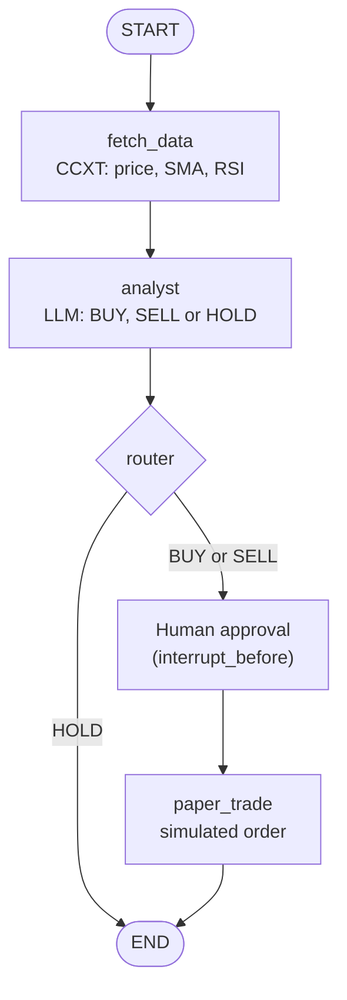

# Agentic AI Crypto Trading Bot

A human-in-the-loop crypto trading agent built with **LangGraph**, **CCXT** and **Python**.
An LLM analyses live market data and proposes a trade, and **you approve or reject it** before anything is executed.

> ⚠️ Educational project. **Paper trading only** (simulated orders, no real money). Not financial advice.

## Milestones

| # | Scope | Status |
|---|-------|--------|
| M1 | HLD/LLD, graph State, CCXT data fetch | ✅ Done |
| M2 | AI analyst node (LLM → BUY / SELL / HOLD) | ⬜ To do |
| M3 | Conditional routing + paper-trade execution | ⬜ To do |
| M4 | Checkpointer, human approval (`interrupt_before`), UI | ⬜ To do |
| M5 | End-to-end testing & interview review | ⬜ To do |

Every milestone is tagged in git (`m1`, `m2`, ...), so you can browse the code at each stage: `git checkout m1`.

## Architecture

Planned flow. **M1 implements `START → fetch_data → END`.**



Design principles

- **Controlled graph, not a free-roaming agent**: predictable and safe when money is involved.
- **The LLM only suggests**; Python rules and a human decide.
- **Small summaries, not raw candles**: fewer LLM tokens and clearer prompts.
- **External calls are isolated** in `data_fetcher.py`, so tests can fake them.

## Project structure

```
.
├── state.py          # TradingState: the shared graph state
├── data_fetcher.py   # CCXT wrapper -> price, SMA, RSI summary
├── nodes.py          # graph nodes
├── graph.py          # builds and compiles the LangGraph
├── main.py           # CLI runner
├── tests/            # pytest suite, one file per milestone
├── NOTES.md          # learning notes (English + සිංහල)
├── pytest.ini
└── requirements.txt
```

## Quick start

Requires Python 3.10+.

```bash
git clone https://github.com/<your-username>/crypto-trading-agent.git
cd crypto-trading-agent
python -m venv .venv
source .venv/bin/activate        # Windows: .venv\Scripts\activate
pip install -r requirements.txt
python main.py
```

No API keys are needed for M1 (public market data).
If Binance is blocked on your network, set `EXCHANGE_ID = "kraken"` in `data_fetcher.py`.

## Tests

```bash
pytest            # offline unit tests (CCXT is faked)
pytest -m live    # optional: calls the real exchange
```

Tested with Python 3.12, langgraph 1.2, ccxt 4.5, pandas 3.0, pytest 9.2.

## Tech stack

Python · LangGraph · CCXT · pandas · pytest
(an LLM API and Streamlit arrive in later milestones)